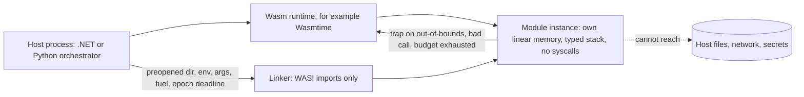

## Explanation

WebAssembly (Wasm) is a portable binary instruction format with a formal semantics, designed from the outset (Haas and colleagues, PLDI 2017) for safe, fast execution of untrusted code. Version 1.0 became a W3C Recommendation in December 2019; 2.0 was declared complete in December 2024 and, like later versions, is maintained in place as an "evergreen" W3C Candidate Recommendation Draft; 3.0 (September 2025) added 64-bit and multiple memories, garbage collection, typed references, tail calls, exception handling, relaxed SIMD and a deterministic profile. *Sandboxing* means using those guarantees to run untrusted code inside your own process, with the host deciding what it may touch.

The virtual machine supplies half of the sandbox:

- **Linear memory.** A module sees a flat array of bytes; every load and store is bounds-checked, mostly for free via virtual memory (on 64-bit hosts Wasmtime by default reserves 4 GiB of address space plus a 32 MiB guard region per 32-bit memory, so an out-of-range access faults instead of needing an explicit check). A pointer is only an offset into that array, so host memory is unaddressable.
- **Hidden control stack.** Return addresses and spilled registers are unreachable from the module, so stack smashing is impossible.
- **Typed, structured control flow.** Branches target only valid labels, indirect calls are type-checked against a function table, and code is immutable, which removes return-oriented gadget chains.
- **No system calls.** The only way out is an import the host linked; anything else traps.
- **Traps.** An out-of-bounds access, bad indirect call or stack overflow terminates the instance at once instead of corrupting state.

The host supplies the second half: capabilities and resource limits. The WebAssembly System Interface (WASI) is the standard host API, and it is capability-based: a module cannot open `/etc/passwd` by name; it can only use the directory handles and sockets the host *preopened* for it, so the default is nothing. WASI 0.1 (Preview 1, the `wasi_snapshot_preview1` ABI) is POSIX-flavoured and still widely deployed. WASI 0.2 (January 2024) rebuilt the interfaces on the **component model**, written in WIT as *worlds* such as `wasi:cli/command` and `wasi:http/proxy`, over interfaces for files, sockets, clocks and random numbers. WASI 0.3.0 (June 2026) made asynchrony native to components (`async func`, `stream<T>`, `future<T>`), removed `wasi:io` and replaced the `wasi:http/proxy` world with `service` and a new `middleware` world; Wasmtime 46 and later enable it by default. Components are shared-nothing, language-neutral and *virtualisable*: another component can satisfy an import, so a tool's HTTP access can pass through a filtering component. Resource limits complete the picture: Wasmtime offers *fuel* (a deterministic instruction budget), *epoch interruption* (cheap wall-clock preemption), a stack-size cap and a resource limiter for memory growth.

Why it exists: plugins, user-defined functions and multi-tenant serverless need to run many small pieces of foreign code with isolation stronger than a thread and cheaper than a VM. Wasmtime reached 1.0 in September 2022, fuzzed, audited and in production at Shopify and Fastly. For this reader the case is agent tooling: MCP's security guidance says local MCP servers should run sandboxed with minimal privileges and explicit grants for directories and network. A tool compiled to Wasm receives exactly one input directory and one outbound host, plus a scoped [capability token](capability-based-authorization.md) for any service it calls, so a prompt-injected tool can neither read the orchestrator's secrets nor scan the network. On Kubernetes the modules run through containerd shims (runwasi, a containerd sub-project) selected by `RuntimeClass` and packaged by SpinKube (a CNCF sandbox project); Docker Desktop's Wasm integration is deprecated, and AKS retired its WASI node-pool preview in May 2025 in favour of SpinKube.

What the sandbox does not cover matters as much: side channels, bugs *within* the module's own linear memory (an overflow still clobbers its own data), whole-function code reuse, denial of service without limits, and above all the host functions you expose, the real attack surface.



## How it differs

| Neighbour | What it is | The decisive difference | How to choose |
| --- | --- | --- | --- |
| [Container isolation](container-isolation.md) | Kernel namespaces, cgroups, seccomp and capabilities around a normal process | Shares the host kernel and has filesystem and network unless restricted; attack surface is the syscall interface | Native binaries, OS dependencies, mature tooling |
| [Capability-based authorization](capability-based-authorization.md) | Scoped, attenuable tokens between services | Same philosophy applied to tokens rather than imports; neither replaces the other | Always pair: sandbox for the code, capabilities for the calls it makes |
| [Least privilege](least-privilege.md) | The principle of task-sufficient access | The sandbox proves it for code; the host identity, roles and tokens still need it | Apply inside and outside the module boundary |

**Versus container isolation.** A container is a process with a restricted view of the kernel: it can call hundreds of system calls, has a writable filesystem and a network interface by default, and its escape surface is every kernel bug reachable through what seccomp allows. A Wasm module cannot make a system call at all; its surface is the handful of imports linked in, and a WASI runtime's filesystem access is capability-based rather than path-based. Containers win on compatibility (anything that runs on Linux) and tooling; Wasm wins on startup time, density and the narrowness of its boundary. The two compose: a Wasm runtime inside a hardened container, as runwasi and SpinKube do, gets both layers.

**Versus capability-based authorization.** WASI preopens are capabilities at the import boundary: the module holds a handle to `/in`, not the authority to open arbitrary paths. A capability token is the same discipline for a network call: the tool holds a token for one tenant's orders, not the authority to query any tenant. An agent tool needs both, because the sandbox cannot see what the token allows and the token cannot see what the module reads.

**Versus least privilege.** The module runs with exactly the imports it was given, which is least privilege by construction. The *host* process, however, still runs under some identity with some role assignments, and anything a host function does on the module's behalf inherits that authority; keep the host's permissions as narrow as the module's.

## Examples

Both examples run an untrusted tool compiled as a WASI 0.1 core module (Rust target `wasm32-wasip1`, which replaced the old `wasm32-wasi` name) with one read-only directory, a fuel budget and a wall-clock deadline. Anything the module imports beyond WASI fails at instantiation.

=== "C#"

    ```csharp
    using Wasmtime;   // NuGet package: Wasmtime 48.x (wasmtime-dotnet, a Bytecode Alliance project)

    using var config = new Config()
        .WithFuelConsumption(true)           // deterministic instruction budget
        .WithEpochInterruption(true)         // cheap wall-clock preemption
        .WithMaximumStackSize(512 * 1024);   // bytes
    using var engine = new Engine(config);
    using var module = Module.FromFile(engine, "tools/summarize.wasm");

    using var linker = new Linker(engine);
    linker.DefineWasi();                     // WASI imports only; any other import fails to instantiate

    using var store = new Store(engine);
    store.SetWasiConfiguration(new WasiConfiguration()
        .WithPreopenedDirectory("/srv/jobs/42/in", "/in", mutable: false)  // the only directory the tool can see, read-only
        .WithEnvironmentVariable("JOB_ID", "42")
        .WithArgs("summarize", "/in/report.txt")
        .WithInheritedStandardOutput());
    store.Fuel = 50_000_000;                 // trap when exhausted
    store.SetEpochDeadline(1);               // trap one epoch tick from now
    using var ticker = new Timer(_ => engine.IncrementEpoch(), null,
        TimeSpan.FromSeconds(5), Timeout.InfiniteTimeSpan);   // the tick: a 5-second wall-clock limit

    var instance = linker.Instantiate(store, module);
    try
    {
        instance.GetAction("_start")!();     // WASI command entry point
    }
    catch (WasmtimeException ex)             // trap: out of fuel, deadline, out-of-bounds access, ...
    {
        Console.Error.WriteLine($"tool terminated: {ex.Message}");
    }
    ```

=== "Python"

    ```python
    # pip install wasmtime  (wasmtime-py, 64-bit Python 3.9+)
    import threading
    from wasmtime import Config, Engine, Linker, Module, Store, WasiConfig, Trap

    config = Config()
    config.consume_fuel = True
    config.epoch_interruption = True
    config.max_wasm_stack = 512 * 1024
    engine = Engine(config)
    module = Module.from_file(engine, "tools/summarize.wasm")

    linker = Linker(engine)
    linker.define_wasi()                      # WASI imports only

    wasi = WasiConfig()
    wasi.preopen_dir("/srv/jobs/42/in", "/in", fs_mutable=False)   # read-only view of one directory
    wasi.env = [("JOB_ID", "42")]
    wasi.argv = ["summarize", "/in/report.txt"]
    wasi.inherit_stdout()

    store = Store(engine)
    store.set_wasi(wasi)
    store.set_fuel(50_000_000)
    store.set_limits(memory_size=64 * 1024 * 1024)   # cap linear memory growth at 64 MiB
    store.set_epoch_deadline(1)                      # trap one epoch tick from now
    ticker = threading.Timer(5.0, engine.increment_epoch)   # the tick: a 5-second wall-clock limit
    ticker.start()

    instance = linker.instantiate(store, module)
    try:
        instance.exports(store)["_start"](store)
    except Trap as trap:                      # out of fuel, deadline, out-of-bounds, ...
        print(f"tool terminated: {trap}")
    finally:
        ticker.cancel()
    ```

=== "Azure"

    There is no managed Wasm runtime on Azure as of October 2026. The AKS *WASI node pools* preview was retired (no new pools after 5 May 2025); Microsoft's documented path is to deploy SpinKube to AKS from the Azure Marketplace, which installs the Spin containerd shim and a `RuntimeClass` so Wasm workloads schedule like pods:

    ```yaml
    apiVersion: apps/v1
    kind: Deployment
    metadata: { name: summarize-tool }
    spec:
      replicas: 2
      selector: { matchLabels: { app: summarize-tool } }
      template:
        metadata: { labels: { app: summarize-tool } }
        spec:
          runtimeClassName: wasmtime-spin-v2
          containers:
          - name: tool
            image: ghcr.io/example/summarize-tool:1.2
            resources: { limits: { cpu: 100m, memory: 64Mi } }
    ```

    For everything else (Azure Container Apps, App Service, Functions), embed the runtime in your own container as the C# example does; the Wasm boundary then sits inside a container that should itself follow the Pod Security *Restricted* profile.

=== "AWS"

    AWS likewise has no first-party Wasm runtime: Lambda has no Wasm managed runtime and ECS or EKS run OCI images. The two production patterns are embedding Wasmtime in a Lambda container image or ECS task (the host is your code, the untrusted part is the module), and EKS with runwasi or SpinKube shims selected by `RuntimeClass`. Keep the Wasm host's IAM role as narrow as the module's imports: a tool that may only read `/in` should run under a task role that can only read the matching S3 prefix, with a session policy if the orchestrator assumes the role per job.

Capability tokens complete the picture for the calls the tool makes out of the sandbox; see [Capability-Based Authorization](capability-based-authorization.md) and [MCP tool orchestration](../ai/protocols/mcp-tool-orchestration.md).

## Misconceptions

- **"Wasm is memory-safe, so a Wasm module has no memory bugs."** The *host* is protected from the module; the module is not protected from itself. A C buffer overflow compiled to Wasm still overwrites the module's own data, and WebAssembly's security notes list this explicitly.
- **"A sandbox needs no resource limits."** Without fuel, epoch deadlines or a memory limiter, an infinite loop or unbounded `memory.grow` is a denial of service against the host; the isolation is for integrity and confidentiality, not availability.
- **"WASI gives modules POSIX access."** WASI is capability-based: no ambient filesystem or network. A module gets only preopened directories and the sockets or HTTP imports the host links, and WASI 0.2 and 0.3 make even those typed interfaces in explicit worlds.
- **"Wasm replaces containers."** They sit at different layers and usually nest: the Wasm runtime runs inside a container or VM, and Kubernetes runs modules through containerd shims. Native dependencies, GPUs and most existing software still need a container.
- **"Side channels are solved."** Wasmtime mitigates Spectre on indirect calls, `br_table` and dynamic-memory bounds checks and treats the rest as ongoing research; timing channels remain, so do not co-locate secrets and attacker-controlled modules on the assumption of perfect isolation.
- **"The component model is a browser feature."** It is standardised in the W3C WebAssembly Community Group and used in production outside the browser through runtimes such as Wasmtime; browsers run core modules and the JavaScript API.

## Exam notes

No mainstream certification tests WebAssembly by name yet, but several test the concepts it embodies. CKS and KCSA cover sandboxed and alternative container runtimes selected through `RuntimeClass`, the Pod Security *Restricted* profile, seccomp and capability dropping, which is the host side of this design; a question about running untrusted tenant code on a cluster expects a stronger isolation boundary than a default container. CISSP, CSSLP and CAS-005 test sandboxing as a secure-design and secure-coding control (least privilege for code, fail-safe defaults, reducing attack surface) and expect you to distinguish isolation of *code* from isolation of *data*. SC-100 and SCS-C03 approach it through workload isolation and the shared-responsibility model: the runtime boundary is yours to configure, and the cloud will not limit a module's imports for you. For the MCPA certification and agent-focused exams, the testable point is that local MCP servers and tools should run with minimal privileges, explicit directory and network grants, and a sandbox technology appropriate to the platform. The recurring trap is treating a sandbox as a substitute for authorization: it limits what code can reach, not what a token it was given can do.

## Self-check

??? question "An orchestrator runs third-party MCP tools as child processes with the orchestrator's own credentials and filesystem. A tool is found exfiltrating the orchestrator's cloud token. Which boundary was missing, and what does a Wasm-based design change?"
    The tool ran with the host's ambient authority: every file, environment variable and network route the orchestrator had. A Wasm sandbox inverts the default: the module gets only the directory the orchestrator preopens, only the environment variables it passes, and no network unless an HTTP import is linked, so the cloud token is simply not reachable. Pair that with a per-call, audience-bound, short-lived capability token for any service the tool must call, and with fuel and epoch limits so a malicious loop cannot starve the host; the orchestrator's own identity should also be narrowed, because host functions still act with its authority.

??? question "Your team proposes replacing all containers with Wasm modules for a .NET service that uses native image libraries and a GPU. Is that a sandboxing win?"
    No. Wasm's isolation comes from a narrow import boundary and a portable instruction set; native libraries, GPU drivers and most OS-level dependencies are exactly what that boundary excludes, so the service would either fail to build or need host imports so broad that the sandbox adds little. The right split is to keep the service in a hardened container (non-root, dropped capabilities, read-only filesystem, Restricted profile) and move only the untrusted, self-contained parts, such as user-provided transforms or agent tools, into Wasm modules that the service hosts with explicit capabilities and limits.

??? question "A security review asks whether a Wasm module can be used to attack a neighbouring module in the same host process. What is the honest answer?"
    Each instance has its own linear memory, table and typed stack, and cannot address another instance's memory or the host's; control flow cannot escape its own code, and a trap terminates only that instance. What remains is what every shared-hardware design has: timing and cache side channels, partially mitigated for Spectre by Wasmtime, and resource exhaustion if fuel, deadlines and memory limits are missing. The disciplined answer is to assume confidentiality across modules is strong but not absolute, to limit resources per instance, and to put secrets in the host rather than in any module that shares a process with attacker-controlled code.

## Further reading

- [Wasm Sandboxing vs. Container Isolation](../security/appsec/wasm-sandboxing.md): the library article on choosing between the two layers.
- [Docker and containerization](../devops/docker-containerization.md) for the container-side hardening that hosts a Wasm runtime, and [MCP tool orchestration](../ai/protocols/mcp-tool-orchestration.md) for the agent use case.
- Term pages: [Container Isolation](container-isolation.md), [Capability-Based Authorization](capability-based-authorization.md), [Principle of Least Privilege](least-privilege.md), [Zero Trust Architecture](zero-trust.md).
- Primary sources: the WebAssembly 3.0 announcement (<https://webassembly.org/news/2025-09-17-wasm-3.0/>), WASI 0.3 release notes (<https://wasi.dev/releases/wasi-p3>), runwasi (<https://github.com/containerd/runwasi>), SpinKube (<https://www.spinkube.dev/>), the wasmtime-dotnet (<https://github.com/bytecodealliance/wasmtime-dotnet>) and wasmtime-py (<https://github.com/bytecodealliance/wasmtime-py>) embeddings, and the MCP security best practices (<https://modelcontextprotocol.io/specification/2026-07-28/basic/security_best_practices>).
