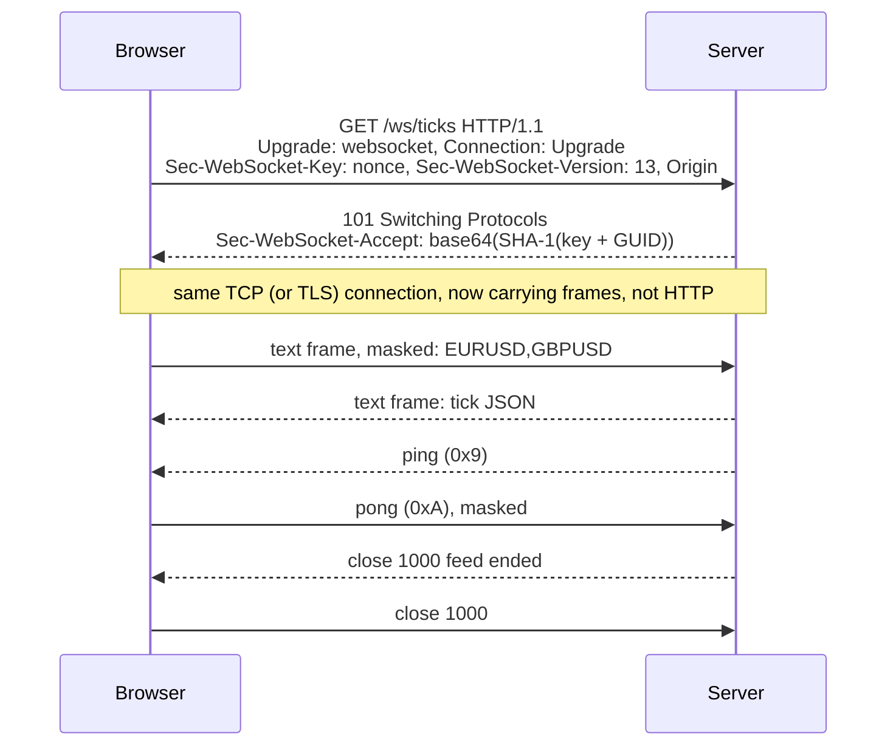

## Explanation

A WebSocket is a long-lived, bidirectional, message-oriented connection between a client (usually a browser) and a server that starts life as an HTTP request and then stops being HTTP. RFC 6455 presents it as a thin layer over TCP that adds an origin-based security model, addressing, framing and a closing handshake; its only relationship to HTTP is that the opening handshake is an HTTP Upgrade request, which lets it share ports 80 (`ws://`) and 443 (`wss://`, over TLS) with web servers and traverse HTTP-aware infrastructure.

The handshake is a GET with `Upgrade: websocket`, `Connection: Upgrade`, a `Sec-WebSocket-Key` (a fresh random 16-byte nonce, base64-encoded), `Sec-WebSocket-Version: 13`, an `Origin` header from browsers, and optionally `Sec-WebSocket-Protocol` and `Sec-WebSocket-Extensions`. The server answers `101 Switching Protocols` with `Sec-WebSocket-Accept`, the base64 SHA-1 of the key concatenated with the GUID `258EAFA5-E914-47DA-95CA-C5AB0DC85B11`, and from then on both sides exchange *frames*: a FIN bit, three reserved bits, a 4-bit opcode (`0x0` continuation, `0x1` UTF-8 text, `0x2` binary, `0x8` close, `0x9` ping, `0xA` pong), a 7-, 16- or 64-bit payload length, and the payload. Client-to-server frames must be *masked* with a fresh unpredictable 32-bit key, not for secrecy but to defeat cache poisoning of intermediaries that might otherwise see attacker-chosen bytes as HTTP. Control frames carry at most 125 bytes, a ping is answered with a pong carrying the same data, and either side closes by sending a close frame with a status code (`1000` normal, `1001` going away, `1002` protocol error, `1008` policy violation, `1009` too big, `1011` server error; `1006` is what a client reports when the connection died without a close frame) and waiting for the peer's close frame.

HTTP/2 has no `Upgrade`, so RFC 8441 bootstraps a WebSocket with an *Extended CONNECT*: the server advertises `SETTINGS_ENABLE_CONNECT_PROTOCOL`, the client sends `CONNECT` with `:protocol: websocket`, and the socket lives on one HTTP/2 stream beside ordinary requests; the key and accept headers are not used, while `Origin`, subprotocols and extensions work as before. Kestrel has supported this since .NET 7 and Chrome, Edge and Firefox (from 128) enable it by default, so an ASP.NET Core WebSocket route must accept `CONNECT` (`[Route]` rather than `[HttpGet]`).

What the protocol does *not* give you explains most production designs. There is no reconnection, resume or message schema; the client gets `onclose` with a code and must decide. There is no application-level flow control, so [backpressure](backpressure.md) is your job, and no request/response correlation unless messages carry ids. Idle connections are killed by proxies unless something pings: ASP.NET Core sends ping frames every two minutes by default (`KeepAliveInterval`) and .NET 9 added `KeepAliveTimeout` to abort when no pong returns, since otherwise a vanished client is never noticed. Authentication happens once at the handshake (cookies, a token in the URL) and the server should check `Origin`. Scaling out needs every server to reach every client, which is why SignalR has a Redis backplane and why managed services (Azure SignalR Service, Azure Web PubSub, Amazon API Gateway WebSocket APIs) hold the connections for you.

This is why the reader's stack rarely uses raw WebSockets. ASP.NET Core SignalR layers a hub protocol (JSON or MessagePack), remote procedure calls in both directions, groups, automatic reconnect and scale-out on top, and picks the transport per connection: WebSockets first, then [Server-Sent Events](server-sent-events.md), then long polling, within what server and client allow. The Angular dashboard therefore talks SignalR, and a raw socket is reserved for a dedicated binary feed where the hub protocol's overhead matters; the [SignalR vs. raw WebSockets](../messaging/realtime/signalr-websockets.md) article weighs that choice.



## How it differs

| Aspect | WebSocket | [Server-Sent Events](server-sent-events.md) | Long polling |
| --- | --- | --- | --- |
| Direction | both, any time | server to client | server to client, one message per request |
| Framing | text or binary frames, fragmentation | UTF-8 event blocks | HTTP bodies |
| Handshake | Upgrade or Extended CONNECT | plain GET | plain GET |
| Reconnect | yours | built into the browser, Last-Event-ID | implicit |
| Overhead per message | a few bytes of frame header | a few bytes of field names | full HTTP headers each time |
| Intermediaries | need Upgrade or CONNECT support | need unbuffered streaming | work everywhere |

**Versus Server-Sent Events.** The decisive question is whether the client talks back often. If it does (chat, collaborative editing, order entry, multiplayer), WebSocket avoids a second channel and gives binary frames. If it mostly listens (token streams, notifications, dashboards), SSE is simpler, reconnects itself and passes through more infrastructure. RFC 6202 adds the long-polling corner: when neither Upgrade nor streaming is possible, holding each request open until there is news still beats polling, at the cost of headers on every message and one extra round trip of worst-case latency.

**Versus backpressure.** A socket gives you a pipe, not a valve. With `SendAsync` awaited per message and a bounded channel feeding it, a slow client slows its own feed; with fire-and-forget sends into an unbounded queue, memory grows until the connection or the process dies. The protocol will not help; TCP flow control only stalls the write.

**Versus an API key.** A key or token is checked on every HTTP request, so revocation takes effect on the next call. A WebSocket is authorised once, at the handshake, and the identity is then implicit for hours. If entitlements can change mid-session, the server needs to re-check periodically or close the socket when the token expires, and clients must handle the resulting `1008` policy-violation close by re-authenticating. The same applies to managed services: API Gateway runs the `$connect` authoriser once per connection.

## Examples

A market-data endpoint: the client sends one subscription message, then the server pushes ticks until the feed ends.

=== "C#"

    ```csharp
    using System.Net.WebSockets;
    using System.Text;
    using System.Text.Json;

    var builder = WebApplication.CreateBuilder(args);
    var app = builder.Build();

    app.UseWebSockets(new WebSocketOptions
    {
        KeepAliveInterval = TimeSpan.FromSeconds(30),   // server-initiated ping frames (default: two minutes)
        KeepAliveTimeout = TimeSpan.FromSeconds(15),    // .NET 9+: abort when no pong arrives (default: disabled)
    });

    app.Map("/ws/ticks", async (HttpContext ctx, ITickFeed feed) =>
    {
        if (!ctx.WebSockets.IsWebSocketRequest)
        {
            ctx.Response.StatusCode = StatusCodes.Status400BadRequest;   // plain GET without Upgrade (or HTTP/2 CONNECT)
            return;
        }

        using var socket = await ctx.WebSockets.AcceptWebSocketAsync();   // completes the 101 / CONNECT handshake
        var buffer = new byte[4 * 1024];
        var first = await socket.ReceiveAsync(buffer, ctx.RequestAborted); // client speaks first: which symbols?
        var symbols = Encoding.UTF8.GetString(buffer, 0, first.Count).Split(',');

        await foreach (var tick in feed.SubscribeAsync(symbols, ctx.RequestAborted))
        {
            if (socket.State != WebSocketState.Open) break;
            await socket.SendAsync(JsonSerializer.SerializeToUtf8Bytes(tick), WebSocketMessageType.Text, endOfMessage: true, ctx.RequestAborted);
        }
        await socket.CloseAsync(WebSocketCloseStatus.NormalClosure, "feed ended", CancellationToken.None);   // close code 1000
    });

    app.Run();

    public interface ITickFeed
    {
        IAsyncEnumerable<Tick> SubscribeAsync(string[] symbols, CancellationToken ct);
    }

    public record Tick(string Symbol, decimal Bid, decimal Ask);
    ```

=== "Python"

    ```python
    import asyncio
    import json
    from websockets.asyncio.server import serve

    async def ticks(websocket):
        symbols = (await websocket.recv()).split(",")           # client speaks first
        async for tick in feed(symbols):                        # your async generator of dicts
            await websocket.send(json.dumps(tick))              # str becomes a text frame (0x1); bytes a binary frame (0x2)
        await websocket.close(1000, "feed ended")

    async def main():
        # ping_interval and ping_timeout keep the connection alive and detect dead peers (both default to 20 s).
        server = await serve(ticks, "0.0.0.0", 8765, ping_interval=20, ping_timeout=20)
        await server.serve_forever()

    asyncio.run(main())

    # Client side:
    # from websockets.asyncio.client import connect
    # async with connect("wss://api.example.com/ws/ticks") as ws:
    #     await ws.send("EURUSD,GBPUSD")
    #     async for message in ws:          # yields until the peer closes
    #         print(json.loads(message))
    ```

=== "TypeScript"

    ```typescript
    import * as signalR from '@microsoft/signalr';

    // SignalR: negotiate, then try WebSockets, then Server-Sent Events, then Long Polling. Restrict when you know the network.
    const hub = new signalR.HubConnectionBuilder()
      .withUrl('/hubs/ticks', {
        transport: signalR.HttpTransportType.WebSockets | signalR.HttpTransportType.ServerSentEvents,
        // skipNegotiation: true is only valid when WebSockets is the sole transport, and not behind Azure SignalR Service
      })
      .withAutomaticReconnect()
      .build();
    hub.on('tick', (t) => render(t));
    await hub.start();

    // Raw browser WebSocket: no fallback, no reconnect, no hub protocol, no custom headers; you own all of that.
    const ws = new WebSocket('wss://api.example.com/ws/ticks', ['ticks.v1']);   // optional subprotocol list
    ws.onopen = () => ws.send('EURUSD,GBPUSD');
    ws.onmessage = (e) => render(JSON.parse(e.data));
    ws.onclose = (e) => console.log(e.code, e.reason);   // 1000 normal, 1001 going away, 1006 no close frame received
    ```

=== "Azure"

    Azure Web PubSub is the managed WebSocket service: it holds the client connections (a single resource scales to one million concurrent connections), offers groups, users and client-side publish/subscribe through its subprotocols, calls your backend through event handlers, and has SDKs for C#, Java, JavaScript and Python as well as Socket.IO and MQTT-over-WebSocket modes; streaming AI-generated tokens is one of its documented uses. Azure SignalR Service plays the same role specifically for SignalR hubs, which is why `skipNegotiation` is not allowed behind it. Azure API Management can front WebSocket APIs natively.

=== "AWS"

    Amazon API Gateway WebSocket APIs terminate the socket and route each JSON message by a route selection expression such as `${request.body.action}` to the `$connect`, `$disconnect`, `$default` or custom routes, integrating with Lambda, HTTP endpoints or AWS services; the backend pushes to a client by POSTing to the `@connections` callback URL. Fixed quotas shape the design: 32 KB frames and 128 KB messages (the connection is closed with `1009` otherwise), no binary media types (`1003`), a 10-minute idle timeout and a two-hour maximum connection lifetime (both closed with `1001`), integration timeouts of 50 ms to 29 s, and 500 new connections per second per account per Region by default. Clients must therefore reconnect at least every two hours and keep the socket busy or expect `1001`.

## Misconceptions

- **"A WebSocket is just HTTP kept open."** Only the handshake is HTTP. After `101` (or the HTTP/2 `CONNECT`), there are no methods, status codes, caching or request headers; intermediaries that do not understand Upgrade or Extended CONNECT drop it, which is why SignalR and friends fall back to SSE and long polling.
- **"Masking makes client frames secure."** Masking defeats cache poisoning in intermediaries; it is not encryption. Confidentiality comes from `wss://` (TLS), and server-to-client frames are not masked at all.
- **"The server is told when a client disconnects."** Only if the client sends a close frame. A dropped network leaves a half-open socket until a ping goes unanswered or a timeout fires, which is what `KeepAliveInterval`, `KeepAliveTimeout` and the Python `ping_timeout` exist for.
- **"SignalR is WebSockets."** SignalR is a hub protocol with RPC, groups, reconnect and scale-out that *prefers* WebSockets and falls back to SSE and long polling; the Java client supports WebSockets only. Raw sockets give you none of the hub features.
- **"Browsers can send custom headers on a WebSocket."** The browser API takes a URL and a subprotocol list. Authentication rides on cookies, a token in the URL, or a first message after connect; server-side clients such as `ClientWebSocket` can set headers.

## Exam notes

The AWS Certified Generative AI Developer – Professional (AIP-C01) outline explicitly asks for real-time interaction with WebSockets or server-sent events and for API Gateway streaming, so expect to choose a WebSocket API for two-way chat and SSE or response streaming for one-way token output. AWS Certified Developer – Associate (DVA-C03) and Solutions Architect – Associate (SAA-C03) test API Gateway's API types and real-time patterns, where the traps are the WebSocket API's fixed limits (two-hour connections, ten-minute idle, 128 KB messages, no binary) and the `@connections` callback for server push. On Azure, Designing Microsoft Azure Infrastructure Solutions (AZ-305) expects Azure SignalR Service or Web PubSub for real-time messaging rather than self-hosted connection state, and the AI exams (AI-103, AI-200) assume streamed output without naming the transport. In all of them, remember the handshake facts that get asked as trivia (Upgrade, 101, ports 80 and 443, `wss` for TLS) and the architectural ones that get asked as scenarios (no reconnect or flow control built in, keepalives, scale-out through a backplane or managed service).

## Self-check

??? question "A trading UI behind a corporate proxy cannot establish the WebSocket but the same build works at home. What is happening and what should the app do?"
    The proxy does not pass the Upgrade handshake (or HTTP/2 Extended CONNECT), so the 101 never arrives. Use a client with transport fallback: SignalR negotiates and drops to Server-Sent Events (server to client) with HTTP POSTs for client messages, then to long polling, all over ordinary HTTP that the proxy allows. If the feed is one-way, SSE alone may be the better design everywhere.

??? question "A server pushes ticks to 5,000 WebSocket clients with fire-and-forget sends and its memory grows during volatile markets until the process restarts. Why, and what is the fix?"
    Slow clients stop reading, their TCP windows fill, and every further send queues in the server's buffers because nothing applies backpressure above TCP. Await each SendAsync, feed each connection from a bounded channel with a policy (wait for lossless streams, DropOldest for latest-value dashboards), and close connections that stall past a threshold with code 1008 or 1011 rather than buffering indefinitely.

??? question "An API Gateway WebSocket API drops every client after exactly two hours, and some messages fail with close code 1009. Which limits are involved?"
    The two-hour maximum connection duration (close 1001) and the 128 KB message size quota (close 1009), neither of which can be raised; frames are also capped at 32 KB, so larger messages must be fragmented. Clients should reconnect proactively before two hours and re-subscribe, large payloads should be split or fetched over HTTP by reference, and the ten-minute idle timeout should be covered by periodic client messages.

## Further reading

- [SignalR and WebSockets](../messaging/realtime/signalr-websockets.md), [real-time UI streaming](../frontend/realtime/real-time-ui-streaming.md) and [REST vs. gRPC APIs](../messaging/apis/rest-vs-grpc-apis.md).
- [Server-Sent Events](server-sent-events.md), [backpressure](backpressure.md), [API key](api-key.md) and [mutual TLS](mtls.md).
- RFC 6455, The WebSocket Protocol: <https://www.rfc-editor.org/rfc/rfc6455> and RFC 8441, Bootstrapping WebSockets with HTTP/2: <https://www.rfc-editor.org/rfc/rfc8441>
- ASP.NET Core WebSockets: <https://learn.microsoft.com/en-us/aspnet/core/fundamentals/websockets>
- Amazon API Gateway WebSocket API quotas: <https://docs.aws.amazon.com/apigateway/latest/developerguide/apigateway-execution-service-websocket-limits-table.html>
