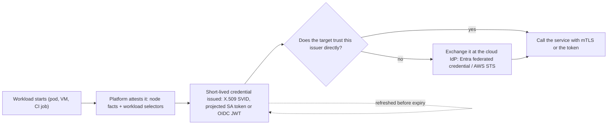

## Explanation

A workload is a single piece of software deployed for a single purpose: a pod, a container, a VM process, a CI job. Workload identity gives that software an identity the platform vouches for, instead of a secret an operator copied into an environment variable. The difference is who proves what: with a secret, the workload proves it was *given* a string; with workload identity, the platform proves what the workload *is* and *where it runs*, and issues a credential on the strength of that proof.

Three moving parts make it work. **Attestation** establishes facts about the process without a shared secret. SPIRE, the reference implementation of the SPIFFE standard, attests the node first (a cloud instance identity document, a Kubernetes service account token or a one-time join token) and then the workload (its Unix uid and binary path, or its Kubernetes namespace and service account), and matches those selectors against registration entries. **Issuance** turns the attested facts into a credential: an X.509 SVID whose URI subject alternative name is the SPIFFE ID `spiffe://trust-domain/path`, or a JWT SVID, fetched over the local Workload API with no secret at all. Kubernetes does its own version with projected service account tokens: the kubelet requests a token bound to the pod and to an audience, defaulting to one hour and never below ten minutes, rotates it once it is older than 80 percent of its lifetime or 24 hours, and invalidates it when the pod is deleted; the application must re-read the file rather than cache it. **Federation** lets a credential from one issuer buy a credential from another: the cluster publishes `/.well-known/openid-configuration` and a JWKS, and a cloud identity provider validates the token against them and exchanges it, through the [client credentials flow](oauth-client-credentials-flow.md) with a `client_assertion`, for its own access token.



Each cloud productises the same idea. On Azure, a VM, App Service or Container App gets a **managed identity** (system-assigned, dying with the resource, or user-assigned and shareable) whose credential is never accessible to you. On AKS, **Microsoft Entra Workload ID** uses token projection and federation: a service account annotated with `azure.workload.identity/client-id`, a pod labelled `azure.workload.identity/use: "true"`, a webhook that injects a token file named by `AZURE_FEDERATED_TOKEN_FILE`, and a **federated identity credential** on a user-assigned managed identity or app registration whose issuer, subject (`system:serviceaccount:<ns>:<sa>`) and audience (`api://AzureADTokenExchange`) must match the token case-sensitively. The same federation accepts GitHub Actions, Google Cloud, AWS and SPIFFE tokens, never Entra-issued ones, with at most 20 federated credentials per identity. On AWS, **EKS Pod Identity** maps a service account to an IAM role through an association, injects `AWS_CONTAINER_CREDENTIALS_FULL_URI` and `AWS_CONTAINER_AUTHORIZATION_TOKEN_FILE`, and has a node agent on `169.254.170.23` call `AssumeRoleForPodIdentity`; the role trusts the `pods.eks.amazonaws.com` principal. Its predecessor, **IAM roles for service accounts (IRSA)**, registers each cluster's OIDC issuer with IAM and has the SDK call `AssumeRoleWithWebIdentity` with the projected token named by `AWS_WEB_IDENTITY_TOKEN_FILE`. GitHub Actions does the same for pipelines: a job with `id-token: write` permission requests a JWT from `token.actions.githubusercontent.com` whose `sub` claim (`repo:org/repo:ref:refs/heads/main`) the cloud checks before issuing short-lived credentials.

Without a platform to attest you, as in a Docker Compose home lab, the fallback is SPIRE with its Unix workload attestor, or a vault that mints short-lived credentials from one guarded bootstrap secret: the "secret zero" that workload identity otherwise eliminates.

## How it differs

**Versus an [API key](api-key.md).** The key is the identity and the proof at once, lives as long as someone remembers to rotate it, and must be distributed to every replica by a human or a pipeline. A workload identity is derived from facts the platform already knows (this pod runs under this service account on this node), is issued fresh with a lifetime measured in minutes or hours, and needs no distribution because the issuing API is local. Pick a key only when the far side offers nothing else or when no platform can attest the caller.

**Versus [secrets rotation](secrets-rotation.md).** Rotation accepts that a secret exists and bounds the damage by replacing it on a schedule; it still has to be stored, fetched, cached and cut over. Workload identity is rotation taken to its limit: the kubelet re-issues the projected token at 80 percent of its lifetime and SPIRE renews SVIDs continuously, and nothing persists that is worth rotating. The honest caveat is that the bootstrap of the attestation chain (the SPIRE server's signing key, the cluster's OIDC signing key, which EKS rotates every seven days) is still a secret somebody rotates.

**Versus [mutual TLS](mtls.md).** mTLS is a presentation mechanism: it proves possession of a private key during a handshake. Workload identity is the issuance mechanism that decides which key and certificate the workload gets. SPIFFE joins them, but the identity can equally be presented as a JWT bearer token to a cloud API over ordinary TLS, which is what every managed identity and federation flow actually does.

**Versus the [OAuth 2.0 client credentials flow](oauth-client-credentials-flow.md).** Client credentials is the protocol step; workload identity federation is what you plug into it. The token request is identical to the certificate case (`client_assertion_type=urn:ietf:params:oauth:client-assertion-type:jwt-bearer`), except that the assertion was minted by Kubernetes or GitHub rather than signed with a certificate you stored. That is why Entra documents federation as the "third case" of its client credentials flow.

| Dimension | Workload identity | API key or client secret | Rotated secret in a vault |
|---|---|---|---|
| Who proves identity | The platform, by attestation | The holder, by possession | The holder, by possession |
| Stored on the workload | Nothing durable; a token file the platform refreshes | The secret, in env or config | A reference, plus a cached value |
| Lifetime | Minutes to a day, auto-renewed | Until rotated | Until the next rotation |
| Blast radius of a leak | One short-lived token, bound to an audience | Everything the key can do, indefinitely | Until the next rotation |
| Works outside a cloud or cluster | Only with SPIRE or an OIDC issuer you run | Yes | Yes |

## Examples

=== "C#"

    ```csharp
    // Azure (AKS with Entra Workload ID): no secret anywhere. The webhook injected AZURE_CLIENT_ID,
    // AZURE_TENANT_ID and AZURE_FEDERATED_TOKEN_FILE; WorkloadIdentityCredential re-reads the projected
    // token on every exchange, so Kubernetes rotation is picked up for free. Azure.Identity >= 1.9.0.
    using Azure.Identity;
    using Azure.Security.KeyVault.Secrets;

    var credential = new DefaultAzureCredential();           // resolves to WorkloadIdentityCredential in-cluster
    var secrets = new SecretClient(new Uri("https://orders-kv.vault.azure.net/"), credential);
    KeyVaultSecret dbPassword = await secrets.GetSecretAsync("timescale-password");

    // Request scopes in v2 form: "<resource>/.default", never a bare resource URI.
    var token = await credential.GetTokenAsync(
        new Azure.Core.TokenRequestContext(["https://management.azure.com/.default"]));
    ```

    ```csharp
    // AWS (EKS Pod Identity or IRSA): the SDK's default credential chain finds the container
    // credential provider through AWS_CONTAINER_CREDENTIALS_FULL_URI (Pod Identity) or the web identity
    // token file (IRSA). Temporary credentials are cached and refreshed by the SDK. Nothing to configure.
    using Amazon.S3;

    var s3 = new AmazonS3Client();
    using var export = await s3.GetObjectAsync("orders-exports", "2026-10-24.parquet");
    ```

=== "Python"

    ```python
    # Azure: identical shape. azure-identity >= 1.13.0 understands the injected environment.
    from azure.identity import DefaultAzureCredential
    from azure.keyvault.secrets import SecretClient

    cred = DefaultAzureCredential()                      # WorkloadIdentityCredential inside AKS
    kv = SecretClient(vault_url="https://orders-kv.vault.azure.net/", credential=cred)
    db_password = kv.get_secret("timescale-password").value

    # If you build a custom client assertion yourself, read the token file every time:
    import os
    assertion = open(os.environ["AZURE_FEDERATED_TOKEN_FILE"]).read()   # kubelet rotates it in place

    # AWS: boto3's default chain picks up Pod Identity or IRSA from the environment.
    import boto3
    s3 = boto3.client("s3")
    export = s3.get_object(Bucket="orders-exports", Key="2026-10-24.parquet")
    ```

=== "Azure"

    ```bash
    # 1. Cluster: OIDC issuer + workload identity (preconfigured on AKS Automatic)
    az aks update -g lab -n aks-lab --enable-oidc-issuer --enable-workload-identity
    ISSUER=$(az aks show -g lab -n aks-lab --query oidcIssuerProfile.issuerUrl -o tsv)

    # 2. Identity and the trust relationship (federated identity credential)
    az identity create -g lab -n orders-mi
    az identity federated-credential create -g lab --identity-name orders-mi --name orders-k8s \
      --issuer "$ISSUER" --subject system:serviceaccount:orders:orders-sa \
      --audiences api://AzureADTokenExchange
    ```

    ```yaml
    # 3. Kubernetes: the annotation picks the identity, the label opts the pod into the webhook
    apiVersion: v1
    kind: ServiceAccount
    metadata:
      name: orders-sa
      namespace: orders
      annotations:
        azure.workload.identity/client-id: "<client id of orders-mi>"
    ---
    apiVersion: apps/v1
    kind: Deployment
    metadata: { name: orders-api, namespace: orders }
    spec:
      selector: { matchLabels: { app: orders-api } }
      template:
        metadata:
          labels:
            app: orders-api
            azure.workload.identity/use: "true"
        spec:
          serviceAccountName: orders-sa
          containers:
            - name: api
              image: ghcr.io/lab/orders-api:1.4.0
    ```

    Grant `orders-mi` an Azure RBAC role on the Key Vault, and the pod authenticates with no secret. The projected token defaults to 3600 seconds (configurable from 3600 to 86400 with `azure.workload.identity/service-account-token-expiration`). Outside AKS the same federated credential accepts GitHub Actions, Azure DevOps, Google Cloud, AWS and SPIFFE tokens; where an app registration is unavoidable, use a managed identity as its federated credential instead of a certificate.

=== "AWS"

    ```bash
    # EKS Pod Identity: install the agent once per cluster, then associate service accounts with roles
    aws eks create-addon --cluster-name prod --addon-name eks-pod-identity-agent
    aws eks create-pod-identity-association --cluster-name prod \
      --namespace orders --service-account orders-sa \
      --role-arn arn:aws:iam::111122223333:role/orders-api
    ```

    ```json
    {
      "Version": "2012-10-17",
      "Statement": [{
        "Effect": "Allow",
        "Principal": { "Service": "pods.eks.amazonaws.com" },
        "Action": ["sts:AssumeRole", "sts:TagSession"]
      }]
    }
    ```

    The trust policy names one service principal for every cluster, so the role is reusable across clusters without editing it; each service account maps to one role in the same account (chain roles for cross-account access), associations are eventually consistent, and up to 5,000 associations per cluster are allowed. Pod Identity runs only on Linux EC2 nodes: for Fargate, Windows nodes or EKS Anywhere you still need IRSA, which means an IAM OIDC provider for the cluster, a trust policy on `sts:AssumeRoleWithWebIdentity` conditioned on the token's `sub` claim, and the `eks.amazonaws.com/role-arn` annotation on the service account. For pipelines, GitHub's OIDC provider plays the same role as the cluster's issuer.

## Misconceptions

- **"A Kubernetes service account token is a long-lived secret like it used to be."** Since v1.24 Kubernetes no longer auto-creates Secret-based tokens; projected tokens are bound to the pod, audience-scoped, time-limited and refreshed by the kubelet. If you need a long-lived token you have to create one deliberately, and you should not.
- **"Managed identity means Azure stores a secret for me somewhere."** The credential is not accessible to you at all, and a managed identity can only be used by the resource it is assigned to; a user-assigned identity can also serve as a federated credential on an app registration so that no certificate exists either.
- **"Workload identity federation works with any token, including one from Entra."** Entra explicitly refuses Entra-issued tokens in federated flows, matches issuer, subject and audience case-sensitively, and caches only the first 100 signing keys of the external issuer.
- **"The platform refreshes the token, so my app can read it once at startup."** The kubelet rewrites the file; a process that cached the first value will start failing after the token's lifetime. The Azure Identity and AWS SDKs re-read it; custom code must do the same.
- **"IRSA and Pod Identity are the same thing with a new name."** IRSA federates through a per-cluster OIDC provider and `AssumeRoleWithWebIdentity`; Pod Identity uses a node agent, the EKS Auth API and a single `pods.eks.amazonaws.com` principal, adds session tags, and does not run on Fargate or Windows.

## Exam notes

This is a headline topic for SC-300, where planning and implementing workload identities is a full domain: choosing between managed identities, service principals, user accounts and managed service accounts, creating and assigning managed identities, and monitoring risky workload identities. SC-100 asks you to design how workloads authenticate to Azure resources and, more recently, how agent identities are handled; SC-900 only needs the definition. AZ-400 and AZ-401 test the practical side: service principals versus system- and user-assigned managed identities, and secretless authentication from GitHub Actions and Azure Pipelines through workload identity federation. AI-103 lists keyless credentials and managed identity for AI services. The trap on all of these is the service principal with a client secret: it is almost never the best answer when a managed identity or federation is available.

On AWS, SCS-C03 covers identity solutions for application and system authentication and DVA-C03 covers federated access, where the Kubernetes-flavoured answer is IRSA or EKS Pod Identity rather than access keys in a Secret; expect distractors that put static keys in Secrets Manager. Know the Pod Identity restrictions (Linux EC2 only) and the IRSA moving parts (OIDC provider, trust policy condition on the subject, service account annotation).

Kubernetes exams approach it from the cluster side: CKS warns about service accounts (disable the default automount, minimise permissions), CKA and CKAD expect ConfigMaps and Secrets rather than tokens for app configuration, and KCSA covers secrets and the mesh. GH-200 tests using the OIDC token with the `id-token` permission for cloud federation. CISSP and Security+ touch it as service-account management and group managed service accounts; the exam-grade idea is that non-human identities need the same lifecycle governance as people, with less tolerance for shared credentials.

## Self-check

??? question "Your .NET 9 reporting job runs as a Kubernetes CronJob on AKS and reads a TimescaleDB password from Key Vault. A reviewer asks why the job has a client secret in a Secret object at all. What do you change, and what remains a secret?"
    Enable the OIDC issuer and workload identity on the cluster, create a user-assigned managed identity with a Key Vault RBAC role, add a federated identity credential whose subject is `system:serviceaccount:reporting:reporting-sa` and audience `api://AzureADTokenExchange`, annotate the service account with the identity's client ID and label the pod template with `azure.workload.identity/use: "true"`. The job then authenticates with `DefaultAzureCredential` and the Secret object is deleted. What remains is the database password itself, fetched at run time, until you move TimescaleDB to certificate or token authentication; and the cluster's token-signing key, which Azure manages.

??? question "A GitHub Actions workflow deploys to both Azure and AWS. The team stores a service principal secret and an IAM access key as repository secrets and rotates them quarterly. How do you remove both without a cutover outage?"
    Give the job `id-token: write` permission and let it request a JWT from `token.actions.githubusercontent.com`. On Azure, add a federated identity credential to a managed identity or app registration whose subject matches the repository and environment (for example `repo:org/repo:environment:prod`) and switch the login step to federation. On AWS, create an IAM OIDC identity provider for GitHub and a role trusting `sts:AssumeRoleWithWebIdentity` with a condition on the same subject. Run both paths in parallel for one release, then delete the repository secrets and revoke the old credentials: federation is additive, so there is no moment where the pipeline has no valid identity.

??? question "In your Docker Compose home lab there is no Kubernetes and no cloud. A teammate says workload identity is therefore impossible and keys in .env are fine. What is the accurate answer?"
    Attestation is weaker but not absent. SPIRE's Unix workload attestor can issue X.509 SVIDs to processes based on uid and binary path, with a SPIRE agent per host joined by a one-time token, which gives you mTLS between services with automatically rotated certificates. Where SPIRE is too heavy, a vault with one bootstrap credential can mint short-lived database and API credentials, which concentrates the problem into a single secret zero that is easier to protect and rotate than a dozen keys in a file. What is not fine is the .env in the repository: at minimum move to Compose secrets mounted as files and rotate on a schedule, which is the subject of secrets rotation.

## Further reading

- [Workload Identity vs. Static Credentials](../security/iam/workload-identity.md) and [mTLS vs. API Keys / Shared Secrets](../security/iam/mtls-vs-api-keys.md) in this library.
- [CI/CD pipelines](../devops/ci-cd-pipelines.md) for OIDC federation from GitHub Actions, and [Docker and containerization](../devops/docker-containerization.md) for Compose secrets.
- Terms: [Mutual TLS](mtls.md), [OAuth 2.0 client credentials flow](oauth-client-credentials-flow.md), [Secrets rotation](secrets-rotation.md), [API key](api-key.md), [Least privilege](least-privilege.md), [Zero trust](zero-trust.md).
- [SPIRE concepts](https://spiffe.io/docs/latest/spire-about/spire-concepts/) for node and workload attestation, and [Kubernetes service account administration](https://kubernetes.io/docs/reference/access-authn-authz/service-accounts-admin/) for bound tokens.
- [IAM roles for service accounts](https://docs.aws.amazon.com/eks/latest/userguide/iam-roles-for-service-accounts.html) and [Managed identities for Azure resources](https://learn.microsoft.com/en-us/entra/identity/managed-identities-azure-resources/overview).
