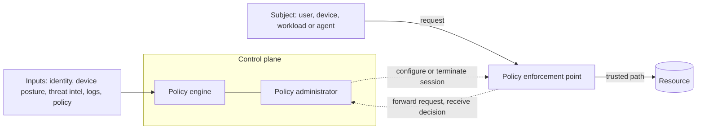

## Explanation

Zero trust replaces the castle-and-moat assumption that being inside the corporate network earns access with one rule: **trust is never implicit and must be continually evaluated**. NIST SP 800-207 (August 2020) defines zero trust as a collection of concepts for enforcing accurate, least-privilege, per-request access decisions in a network viewed as compromised, and a zero trust *architecture* as an enterprise plan built on those concepts. The lineage runs from the Jericho Forum's de-perimeterisation work (2004) and the US Department of Defense "black core", through the term's coining at Forrester, to Google's BeyondCorp (2014), which put corporate applications on the internet and tied access to user and device credentials rather than network position.

SP 800-207's seven tenets, paraphrased: every data source and computing service is a resource; all communication is secured regardless of location; access is granted per session with least privilege; access is decided by dynamic policy weighing identity, asset state and behavioural or environmental signals; the enterprise monitors the posture of every asset it owns or associates with; authentication and authorization are dynamic, enforced before access and re-evaluated during a session; and the enterprise collects as much telemetry as it can to improve policy.

The mechanics are three logical components. The **policy engine (PE)** makes the grant/deny decision from enterprise policy plus external inputs. The **policy administrator (PA)** executes it, creating or tearing down the session and issuing any session credential. Together they form the **policy decision point (PDP)**. The **policy enforcement point (PEP)** sits in the data path, enabling, monitoring and terminating the connection; it may be split into a client agent and a resource-side gateway, or be a single portal. PDP and PEPs talk over a logically separate **control plane**; application traffic flows on the **data plane**, and resources should be unreachable except through a PEP. Inputs include device posture (continuous diagnostics), compliance rules, threat intelligence, activity logs, data-access policy, PKI, the identity system and the SIEM. The *trust algorithm* may be criteria-based (every condition must hold) or score-based (a confidence threshold), and singular (each request alone) or contextual (the subject's history counts); NIST's ideal is contextual.

NIST describes three approaches, usually combined: identity-governance-driven policy (which suits SaaS-heavy estates), micro-segmentation (gateways or host firewalls as PEPs around small resource groups) and software-defined perimeters (an overlay network configured by the PA). Deployment variants include a device agent plus resource gateway, enclave gateways for legacy systems, a resource portal for BYOD, and endpoint application sandboxing. Migration is incremental: SP 800-207 expects perimeter and zero trust components to coexist indefinitely and recommends starting with one low-risk business process after inventorying assets, subjects and workflows. NIST SP 1800-35 (June 2025) documents nineteen example implementations, and CISA's Zero Trust Maturity Model v2.0 (April 2023) grades five pillars (Identity, Devices, Networks, Applications and Workloads, Data) across four stages (Traditional, Initial, Advanced, Optimal), with visibility and analytics, automation and orchestration, and governance cutting across them.

In the reader's stack the pieces map cleanly. Microsoft Entra Conditional Access is the user-facing PDP (Microsoft calls it its Zero Trust policy engine), evaluated after first-factor authentication on device, location, application and risk signals. The ASP.NET Core API is a per-call PEP, validating audience and scopes on every request rather than trusting a session. Between services, [mTLS](mtls.md) with [workload identity](workload-identity.md), often provided by a [service mesh](service-mesh.md), authenticates and encrypts every connection regardless of which subnet Redis or TimescaleDB sit on. Finally, SP 800-207 flags non-person entities, including AI agents, as subjects needing the same scrutiny: they often authenticate with weaker factors and can be coerced into acting for an attacker.



## How it differs

| Neighbour | What it is | The decisive difference | How to choose |
| --- | --- | --- | --- |
| [Least privilege](least-privilege.md) | The principle of granting only task-sufficient access | Least privilege is the *content* of a decision; zero trust is the *architecture* that makes and re-makes the decision per request | Both, always; one without the other fails |
| [mTLS](mtls.md) | Both sides of a TLS connection present certificates | Proves identity at the transport layer; says nothing about policy, posture or context | A building block for tenet 2; not a zero trust strategy by itself |
| [Service mesh](service-mesh.md) | Sidecar proxies that handle service-to-service traffic | Distributes PEPs next to workloads, but has no view of users, devices or data classification | Workload-to-workload enforcement inside clusters |
| [Workload identity](workload-identity.md) | Short-lived, platform-issued identity for processes | A subject identity, not a decision system | Required input for any zero trust policy about services |

**Versus least privilege.** You can have a perfectly scoped role in a flat network where any machine can reach the database port; that is least privilege without zero trust. You can also have every request verified by Conditional Access and then granted Owner; that is zero trust tooling without least privilege. Zero trust supplies the *when* (every request, continuously) and the *inputs* (identity, device, behaviour); least privilege supplies the *how much*.

**Versus mTLS.** Mutual TLS answers tenet 2, secure communication regardless of location, and nothing else. It cannot tell a compromised-but-validly-certified workload from a healthy one, nor can it express "only during business hours from a compliant device". Treat it as the channel the PEP relies on, and put policy somewhere with context.

**Versus a service mesh.** A mesh is a convenient way to deploy a PEP beside every pod and to enforce mTLS and authorization policies between workloads. It is one pillar's worth of zero trust (applications and workloads, partly networks). The identity, device and data pillars, the policy engine fed by posture and threat intelligence, and the governance around them live elsewhere.

**Versus workload identity.** A SPIFFE identity or a managed identity gives the policy engine a subject it can reason about and revoke. Without a PDP consulting posture and context, and PEPs that enforce its answer, the identity is just a stronger credential presented to a service that still trusts everything inside its subnet.

## Examples

=== "C#"

    ```csharp
    // ASP.NET Core (.NET 9) API acting as a per-request PEP: every call re-validates the token
    // for this audience, and a policy requires the exact scope. Sign-in itself was decided by the
    // identity provider's policy engine (for example Conditional Access).
    using System.Security.Claims;
    using Microsoft.AspNetCore.Authorization;

    var builder = WebApplication.CreateBuilder(args);

    builder.Services.AddAuthentication("Bearer").AddJwtBearer("Bearer", o =>
    {
        o.Authority = builder.Configuration["Auth:Authority"];       // the trusted issuer
        o.Audience  = builder.Configuration["Auth:Audience"];        // api://orders, never a token for another API
        o.MapInboundClaims = false;                                  // keep "scp" as "scp" instead of a long URI claim type
        o.TokenValidationParameters.NameClaimType    = "name";
        o.TokenValidationParameters.ValidateIssuer   = true;
        o.TokenValidationParameters.ValidateAudience = true;
        o.TokenValidationParameters.ValidateLifetime = true;
    });

    builder.Services.AddAuthorizationBuilder()
        .AddPolicy("orders.write", p => p.RequireAuthenticatedUser().RequireAssertion(ctx =>
            // "scp" is one space-separated string such as "orders.read orders.write"
            ctx.User.FindFirst("scp")?.Value.Split(' ').Contains("orders.write") == true))
        .SetFallbackPolicy(new AuthorizationPolicyBuilder().RequireAuthenticatedUser().Build()); // deny by default

    var app = builder.Build();
    app.UseAuthentication();
    app.UseAuthorization();

    app.MapPost("/orders", (OrderRequest req, ClaimsPrincipal user) =>
            Results.Created($"/orders/{Guid.NewGuid()}", new { by = user.Identity?.Name }))
       .RequireAuthorization("orders.write");

    app.Run();

    record OrderRequest(string Symbol, int Quantity);
    ```

=== "Python"

    ```python
    # FastAPI PEP: validate issuer, audience and lifetime on every request using the IdP's JWKS,
    # then enforce the scope. No session cache, no network-based exceptions.
    import jwt
    from fastapi import Depends, FastAPI, HTTPException, Request

    ISSUER, AUDIENCE = "https://login.example.com/tenant/v2.0", "api://orders"
    JWKS_URI = "https://login.example.com/tenant/discovery/v2.0/keys"   # the jwks_uri from the issuer's OIDC discovery document
    jwks = jwt.PyJWKClient(JWKS_URI)

    def principal(request: Request) -> dict:
        token = request.headers.get("authorization", "").removeprefix("Bearer ").strip()
        try:
            key = jwks.get_signing_key_from_jwt(token).key
            return jwt.decode(token, key, algorithms=["RS256"], audience=AUDIENCE, issuer=ISSUER)
        except jwt.PyJWTError as e:
            raise HTTPException(401, str(e)) from e

    def scope(required: str):
        def dep(claims: dict = Depends(principal)) -> dict:
            if required not in claims.get("scp", "").split():
                raise HTTPException(403, f"insufficient_scope: {required}")
            return claims
        return dep

    app = FastAPI()

    @app.post("/orders")
    def create_order(order: dict, claims: dict = Depends(scope("orders.write"))):
        return {"accepted": True, "by": claims.get("preferred_username")}
    ```

=== "Azure"

    Microsoft Entra Conditional Access is the PDP for users and, through Conditional Access for agents, for Microsoft Entra agent identities. A policy is an if-then rule over signals (user or group, application, device state, location, real-time risk from Entra ID Protection) that ends in a decision (block, or grant with controls such as MFA, authentication strength, a compliant or hybrid-joined device, an app protection policy). The Microsoft Graph representation, created here in report-only mode first:

    ```json
    {
      "displayName": "Trading API: MFA and compliant device",
      "state": "enabledForReportingButNotEnforced",
      "conditions": {
        "users": { "includeGroups": ["<traders-group-id>"] },
        "applications": { "includeApplications": ["<trading-api-app-id>"] },
        "clientAppTypes": ["all"]
      },
      "grantControls": { "operator": "AND", "builtInControls": ["mfa", "compliantDevice"] }
    }
    ```

    Continuous access evaluation closes the gap between token issuance and policy change: Exchange Online, SharePoint Online and Teams subscribe to critical events (account deleted or disabled, password changed or reset, MFA enabled for the user, admin revocation of refresh tokens, high user risk) and enforce them in near real time, and those services plus Microsoft Graph enforce IP-based Conditional Access location policies inside the service. CAE sessions use long-lived tokens (up to 28 hours) precisely because revocation is event-driven rather than timer-driven. Microsoft Entra Private Access, part of Global Secure Access, is the VPN replacement for private applications: the Global Secure Access client tunnels only the configured FQDNs and IP ranges through Microsoft's service, a private network connector inside your network brokers the connection to the app, and each app is gated by Conditional Access.

=== "AWS"

    AWS Verified Access provides VPN-less access to applications and evaluates *each* request against policy using identity data (IAM Identity Center or an OIDC provider) and device trust data from Jamf, CrowdStrike or JumpCloud. Policies are written in Cedar and attached to a Verified Access group, optionally refined per endpoint; each trust provider's claims appear in the policy context under the policy reference name you chose when configuring it (here `identity` for an OIDC user trust provider and `crwd` for CrowdStrike device trust):

    ```text
    permit(principal, action, resource)
    when {
        context.identity.email like "*@example.com" &&
        context.identity.groups.contains("traders") &&
        context has "crwd" && context.crwd.assessment.overall >= 80
    };
    ```

    Inside the VPC, the same tenets apply with different tools: IAM roles with temporary credentials as workload identity, VPC endpoint policies and security groups as micro-segmentation PEPs, and `aws:SourceArn` and `aws:SourceAccount` conditions so service principals cannot be steered into acting for the wrong account.

Between your own services, a service mesh such as Istio enforces mTLS and per-workload authorization policies, so a Redis Streams consumer and the TimescaleDB writer can only be reached by the identities you list, never by anything that merely lands on the same subnet. See [SignalR and WebSockets](../messaging/realtime/signalr-websockets.md) for keeping the Angular client's real-time channel inside the same per-request authorization model.

## Misconceptions

- **"Zero trust means trusting nothing."** It means no *implicit* trust. The PEP still establishes an explicit trust zone between itself and the resource; the design goal is to make that zone as small as possible, not to abolish it.
- **"Zero trust is a product, or equals an identity-aware proxy."** NIST describes an enterprise-wide plan spanning identity, devices, networks, applications and data, with telemetry feeding policy. A ZTNA gateway replaces one perimeter control; it does not, by itself, change how workloads or data are governed.
- **"We removed the VPN, so the perimeter is gone."** SP 800-207 expects perimeter and zero trust components to coexist indefinitely; the perimeter is simply no longer the thing that grants trust.
- **"MFA everywhere is zero trust."** MFA strengthens one signal, identity assurance. Tenets 4 to 6 require device posture, behaviour, continuous re-evaluation and dynamic policy, which MFA does not provide.
- **"Zero trust is for humans; services inside the cluster are fine."** Tenet 1 makes every data source and computing service a resource, and SP 800-207 explicitly lists non-person entities and software agents as subjects, warning that they are attractive deputies for attackers.
- **"The PDP must be in the data path."** Only the PEP is; the policy engine and administrator communicate over a separate control plane, which is also why their availability and hardening are the architecture's main new threats.

## Exam notes

SC-100 is the exam that tests zero trust most directly: expect to map Microsoft's three principles (verify explicitly, use least privilege, assume breach) to designs, to choose Conditional Access, Entra ID Protection, Intune compliance, Defender and Private Access for specific pillars, and to recognise that a design that trusts an IP range is the wrong answer. SC-900 and SC-300 ask for the principles and for Conditional Access signals and grant controls; AZ-305 and AZ-500 use zero trust as the reason behind private endpoints, managed identities and just-in-time access. On AWS, SAP-C03 and SCS-C03 test Verified Access as the VPN-less answer and the pattern of IAM roles plus VPC endpoint policies plus service-principal conditions. CISSP, CCSP, CAS-005 and Security+ test the NIST vocabulary: the seven tenets, PDP versus PEP, control plane versus data plane, and the CISA pillars and maturity stages. KCSA and CKS approach it as mesh mTLS, network policies and workload identity. A recurring trap across all of them is an answer that strengthens the perimeter (a bigger firewall, a longer VPN session) when the scenario asks for per-request, context-aware decisions; another is confusing the policy engine (decides) with the enforcement point (acts).

## Self-check

??? question "A company has moved its internal apps behind a ZTNA gateway that checks identity and device compliance, but inside the VPC the trading API still accepts any connection from the application subnet. Which tenets are unmet and what is the fix?"
    The ZTNA gateway satisfies per-session, policy-based access for users (tenets 3, 4 and 6) at the edge, but inside the VPC the API still treats network location as trust, violating tenets 1 and 2: every service is a resource and all communication must be secured regardless of location. Give each workload a platform-issued identity, require mTLS between services (a service mesh or SDK-level configuration), put an authorization policy on the API that names the identities allowed to call it, and make the API validate token audience and scope on each request. The subnet becomes irrelevant to the decision, which is the point.

??? question "Your policy engine runs as a single instance in one region. A reviewer calls this a zero trust risk even though its decisions are correct. Why?"
    In a ZTA, no session starts without the PE and PA, so they are the enterprise's new single point of failure; NIST lists denial of service against, and subversion of, the PE and PA as the architecture's distinctive threats. Correct decisions do not help if the component is unreachable or if an administrator with configuration access can quietly change policy. Replicate the PDP across regions, make PEPs fail safely with a defined behaviour, log and audit every policy change, and restrict configuration access to dedicated administrator identities with just-in-time elevation.

??? question "An AI agent with its own identity calls internal tools on behalf of many employees. How should a zero trust design treat it differently from a human user, and why?"
    SP 800-207 treats agents as non-person entities that are subjects in their own right and warns they often authenticate with weaker factors and can be coerced into acting for an attacker. Treat the agent as a subject with its own workload identity, evaluate its requests through the same PDP with policies specific to it, and keep the human's authority separate: the agent should receive audience-bound, scoped, short-lived tokens for each tool call rather than the user's broad token. Make its activity a first-class input to contextual trust scoring, so a sudden change in which tools it calls or how often triggers re-evaluation or denial.

## Further reading

- [Workload Identity](../security/iam/workload-identity.md), [mTLS vs. API Keys](../security/iam/mtls-vs-api-keys.md) and [Capability-Based AuthZ vs. RBAC](../security/iam/capability-based-authz.md): the identity, channel and authorization building blocks.
- [MCP tool orchestration](../ai/protocols/mcp-tool-orchestration.md) for treating agents as zero trust subjects, and the [Security](../security/index.md) and [Cloud](../cloud/index.md) hubs.
- Term pages: [Principle of Least Privilege](least-privilege.md), [Service Mesh](service-mesh.md), [Sidecar Pattern](sidecar-pattern.md), [Role-Based Access Control](rbac.md), [OAuth Authorization Code Flow](oauth-authorization-code-flow.md).
- Primary sources: Microsoft Entra Conditional Access (<https://learn.microsoft.com/en-us/entra/identity/conditional-access/overview>), continuous access evaluation (<https://learn.microsoft.com/en-us/entra/identity/conditional-access/concept-continuous-access-evaluation>) and AWS Verified Access (<https://docs.aws.amazon.com/verified-access/latest/ug/what-is-verified-access.html>).
